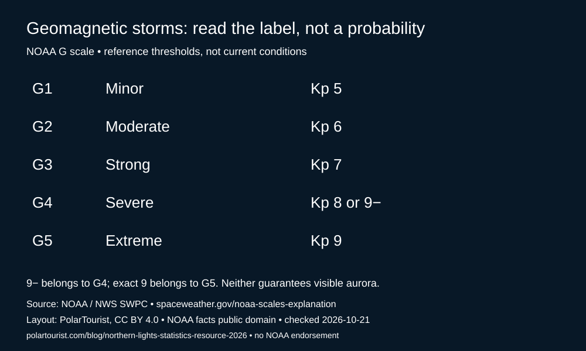

# PolarTourist: geomagnetic storm-scale teaching kit

A small, bounded, offline educational reference: five NOAA G-scale rows, a strict lookup for NOAA's listed Kp labels, reproducible accessible SVG, CSV/JSON parity validation, and a self-contained notebook. **Not an observations dataset, forecast, sighting probability, or comprehensive Kp converter.** No dependencies beyond Python 3.10+.

## Run
```sh
python3 scripts/validate.py
python3 -m unittest discover -s tests -v
python3 scripts/render_chart.py
python3 scripts/run_notebook.py
```
Open `notebooks/storm_scale.ipynb` in Jupyter/Kaggle; its input cell also finds the CSV recursively under `/kaggle/input`. The notebook creates a readable reference table and verifies that G4 includes the categorical label `9−`, which must not be confused with exact Kp 9 (G5). The lookup intentionally rejects decimals, unknown values and fractional labels not listed by the source rather than inventing boundaries.



## Provenance and rights
Source: NOAA / NWS Space Weather Prediction Center, [Space Weather Scales](https://www.spaceweather.gov/noaa-scales-explanation), checked 21 October 2026. These five rows are the NOAA subset of the existing [PolarTourist statistics explanation](https://polartourist.com/blog/northern-lights-statistics-resource-2026). Compared manually to NOAA; no full source scraper or continuing update service is claimed. Transformations: extract level/label/Kp only, reorder ascending, add attribution and ordinal display order. We omit source event-frequency estimates and geographic examples to avoid implying trip success probabilities.

NOAA/NWS source facts are public-domain information under the [NWS reuse policy](https://www.weather.gov/disclaimer), not our copyrighted observations. No endorsement or NOAA affiliation. Original code is MIT; original explanatory writing and chart layout are CC BY 4.0. See `LICENSE` and `RIGHTS.md`; neither license overrides upstream rights.

**SILSO values and existing sunspot charts are deliberately NOT bundled.** SILSO's [citation policy](https://www.sidc.be/SILSO/citations) and [annual-series documentation](https://www.sidc.be/SILSO/infosnytot) specify CC BY-NC 4.0. PolarTourist's own CC BY notice cannot waive that restriction. Commercial/affiliate promotional redistribution requires a separately established permission basis. A cycle-maxima/annual-means chart is therefore not part of this release.

## Interpretation
Kp is an index of planetary geomagnetic disturbance. NOAA's G scale labels storm severity, not local visibility. A traveller also needs darkness, suitable latitude, clear skies and timing. Annual mean sunspot numbers and 13-month smoothed cycle maxima are different summaries of solar activity, not Kp, and none supplies a nightly sighting percentage. Do not use this kit for safety-critical decisions. Check official current products for current conditions.

## Tableau Public
Connect `data/noaa_geomagnetic_scale.csv` as text. Make `level`, `label`, `kp_display` dimensions; `sort_order` is an ordinal sorting helper, NOT a physical magnitude. Sort level ascending by sort_order; create a text table with level/label/kp_display. Do not plot Kp strings as numeric probabilities. Use `charts/noaa-g-scale.svg` as the portable editorial chart. Source attribution must remain in the workbook description. This is compatible input plus instructions, not a published Tableau workbook.

See `DATA_DICTIONARY.md`, `METHODS.md`, and the executed notebook.
